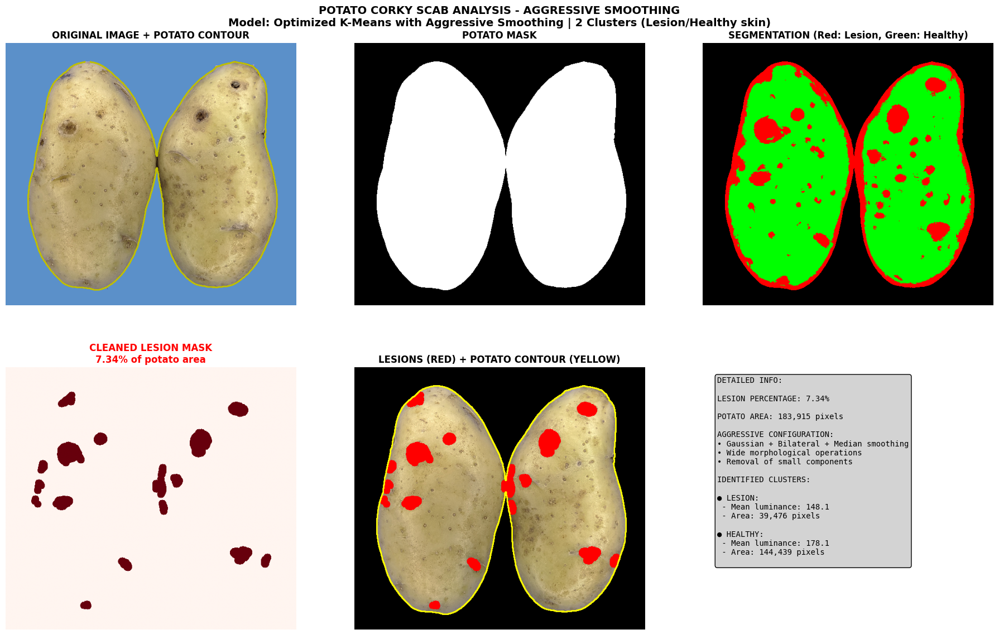
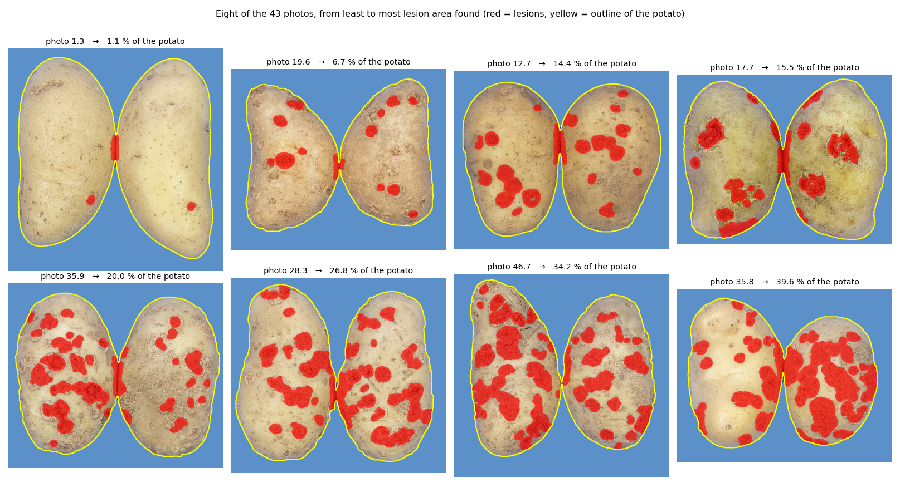
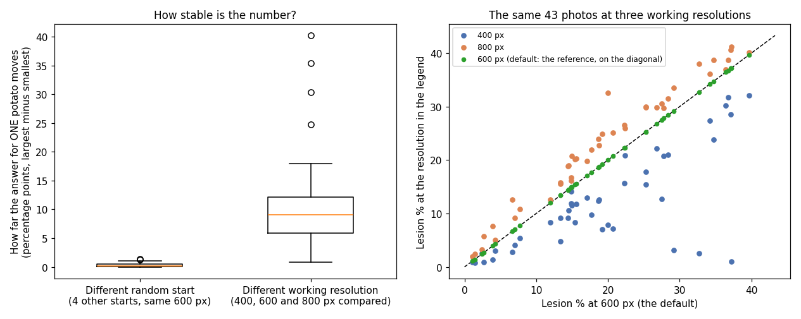

# corky-scab – how much of a potato is covered by corky scab?

You give it a photo of a potato on a blue background, and it tells you **what percentage of the potato's surface is covered by corky scab lesions**, and shows you exactly which parts it counted.



## Why I built it, and what it is for

Corky scab shows up as rough, darker patches on the skin of the tuber. To compare potatoes (varieties, treatments, batches), someone has to decide *how much* of each tuber is affected, and doing that by eye is slow and changes from person to person, and even from one day to the next.

So I wrote a small tool that turns a photo into a number. It is meant for anyone who needs to **measure the lesion area on many tubers photographed in the same way** (same blue background, similar lighting), for example to compare groups or to rank samples. It is a classical image-analysis tool: it does not need any hand-annotated examples and does not use a neural network, so everything it does can be followed step by step.

It is a research and portfolio project, not a validated measuring instrument: see "How reliable is it?" below.

## How it works

The idea in one sentence: *separate the potato from the blue background, then sort the potato's pixels into "darker, rough" and "lighter, smooth" and report the share of the first group.* In more detail (this is what the six panels above show):

1. **Find the potato.** The background is blue and the potato is not, so everything that is not blue (in the HSV colour space, where blue is easy to isolate) is the potato. Small blobs are discarded.
2. **Smooth the skin.** I blur the image on purpose (three different filters one after the other) so that tiny dots, such as skin pores, do not count as lesions; only patches do. Then I raise the local contrast of the brightness so that dark and light areas separate better.
3. **Describe every pixel with four numbers:**
   - how light or dark it is,
   - its colour on the green–red axis,
   - how rough the surroundings are (how fast brightness changes), and
   - how different it is from the pixels around it.
4. **Sort the pixels into two piles with K-Means.** K-Means is a method for finding groups: I do not tell it what a lesion looks like. It looks at the four numbers of every pixel and splits the pixels into two piles so that pixels in the same pile look as alike as possible. The pile that is darker on average is called "lesion" and the other "healthy skin".
5. **Clean up.** The first sorting is noisy, so I remove thin lines and small specks with morphological operations and keep only blobs of a minimum size.
6. **Count.** Lesion pixels ÷ potato pixels × 100. For the example above: 183,915 pixels of potato and **7.34 %** of lesion.

*Why K-Means and not a neural network?* I had no photos with hand-drawn lesion outlines to train on, and K-Means needs none. It is also fast and easy to explain.

## How I made it

The photos are very large (the one above is 9694 × 8747 pixels, about 85 megapixels), so the first thing the tool does is shrink them to 600 pixels wide. All the filter sizes in the code are defined for that size.

I started by cropping a few lesions and a healthy area from one photo and plotting their colour histograms, to see what separates one from the other. Then I tried several versions of the recipe (different smoothing, different features, different numbers of groups) on a handful of photos (3.0, 1.3, 5.4 and 8.1) and kept the one whose red patches matched the lesions I could see by eye. That is the version in this repository: brightness, colour, texture and local contrast as features, strong smoothing, and K-Means with two groups.

## Samples

I ran it on 43 photos. These are eight of them, from the least to the most lesion area found. The names are the sample numbers of the photos:



Over the 43 photos the lesion area found goes from 1.1 % to 39.6 % of the potato (median 18.6 %).

## How reliable is it?

**I have no reference measurement for these photos** (no hand-drawn lesion masks and no visual score), so I cannot tell you how *accurate* the percentage is. What I can tell you is what I checked:

- **By eye,** the red patches follow the dark rough spots well in the photos I looked at (see the samples above).
- **Is it stable?** I ran the same 43 photos again changing things I did not mean to change:



  - **A different random start for K-Means** barely matters: the percentage of a photo moves by about **0.2 points** (at most 1.4 points).
  - **A different working resolution matters a lot.** I compared three: 400, 600 (the default) and 800 pixels wide. In the right-hand plot the 600 px result is the diagonal itself, so the further a dot is from the dashed line, the more that photo changed. Across the three, the percentage of one photo moves by about **9 points** (up to 40). Compared with the 600 px result, at 800 px the ranking of the potatoes stays almost the same (rank agreement 0.99), but at 400 px it changes more (0.69), and the numbers shift (on average −7 points at 400 px and +3 points at 800 px). So the number is tied to the 600 px setting. Always analyse every photo the same way, and do not compare with percentages made at another size.
- **A known false alarm:** in most of the photos shown above, the narrow dark strip where the two potatoes touch (a shadow) is marked as lesion. It adds a little to the total.
- **It always makes two piles.** K-Means splits any potato in two, whether it has lesions or not. In a test with an artificial, perfectly lesion-free potato (with a little noise added) it reported 94.5 % lesions; in the same test with painted lesions covering 12.1 % it reported 14.7 %. Real photos behave better than this artificial one, but it shows that the method cannot say "there are no lesions" by itself.

## Things to keep in mind

- **A blue background and even light.** The potato is found as "not blue"; with another background the mask will fail.
- **Not validated against a manual measurement** of the lesion area. The percentages are what the method produces, tuned by eye on a handful of photos.
- **The percentage is relative to the visible surface** in the photo (one side of the potatoes), not to the whole tuber.
- **Research-grade code:** it prints progress messages with emojis and silences warnings globally.

## Install and use

```bash
pip install .
```
```python
import corky_scab as cksc
perc, mask, fig = cksc.analyze_corky_scab("examples/3.0.jpg", return_fig=True)
cksc.save_figures(fig, out_dir="outputs", base_name="3_0_analysis")
df = cksc.analyze_corky_scab_to_df("examples/3.0.jpg"); cksc.save_results_df(df, "outputs/results.csv")
```
The demo notebook is in `notebooks/demo_corkyscab.ipynb`.

## Built with

OpenCV (finding the potato and the filters), scikit-learn (K-Means), scikit-image, NumPy, pandas and matplotlib.

> **Note:** originally developed and run in Google Colab. Google-Drive mounting cells were removed, Drive paths were rewritten as relative paths and outputs were stripped (figures of the original run are in `assets/`). The paths/cleanup were **not re-executed** after this change, so expect to adjust paths.

## Author
Tiago Alejo Herrador — MIT licensed.
